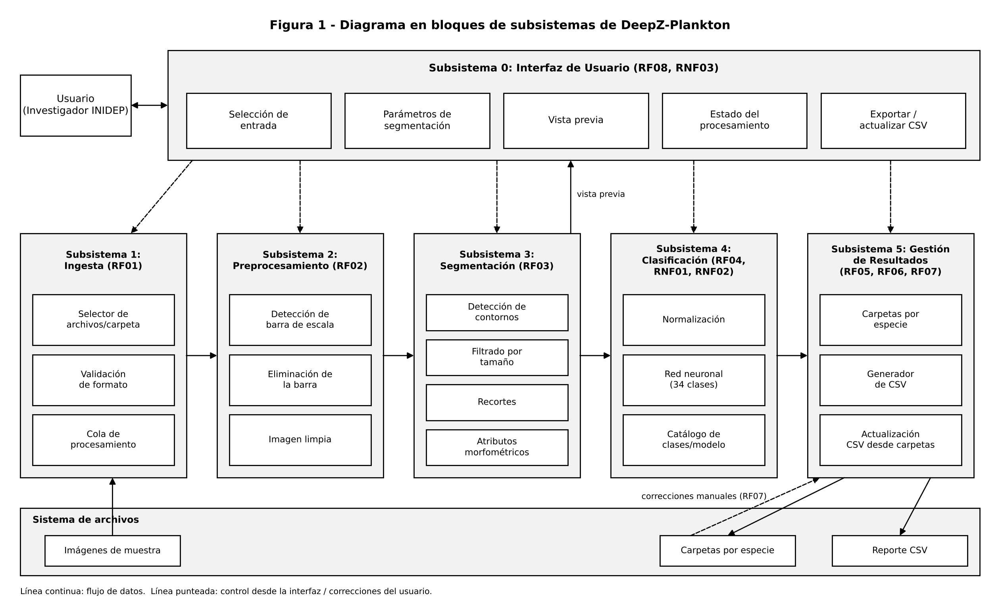

# DeepZ-Plankton

Clasificador y cuantizador de zooplancton implementado con redes neuronales.

Trabajo Final de Grado – Ingeniería en Computación (UNMdP)
Autor: Castiñeira, Santiago José
Cliente: INIDEP

## Descripción

DeepZ-Plankton procesa imágenes escaneadas de muestras de zooplancton y entrega cada espécimen clasificado por especie (34 clases del Mar Argentino), organizado en carpetas, junto con un reporte CSV con sus atributos morfométricos.

Flujo del sistema:

1. **Ingesta**: carga de imágenes en lote.
2. **Preprocesamiento**: eliminación automática de la barra de escala.
3. **Segmentación**: parametrizable, con vista previa en tiempo real.
4. **Clasificación**: red neuronal de 34 clases.
5. **Gestión de resultados**: carpetas por especie, reporte CSV y actualización del CSV desde las carpetas.



## Estructura

```
docs/   Documentación del proyecto (especificación funcional, diagramas)
src/    Código fuente
```

## Documentación

- [Especificación Funcional](docs/Especificacion_Funcional.pdf)
